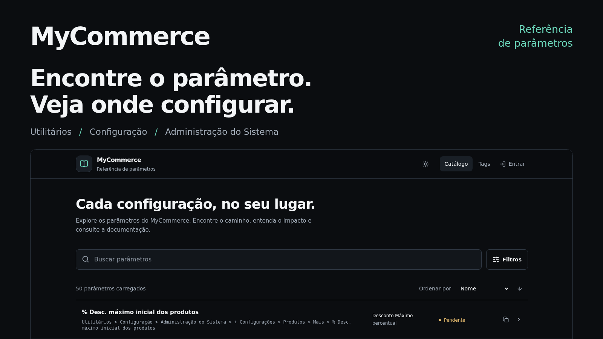
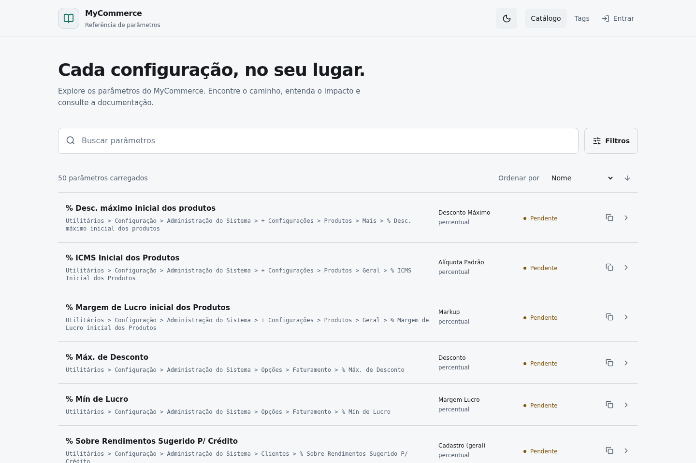
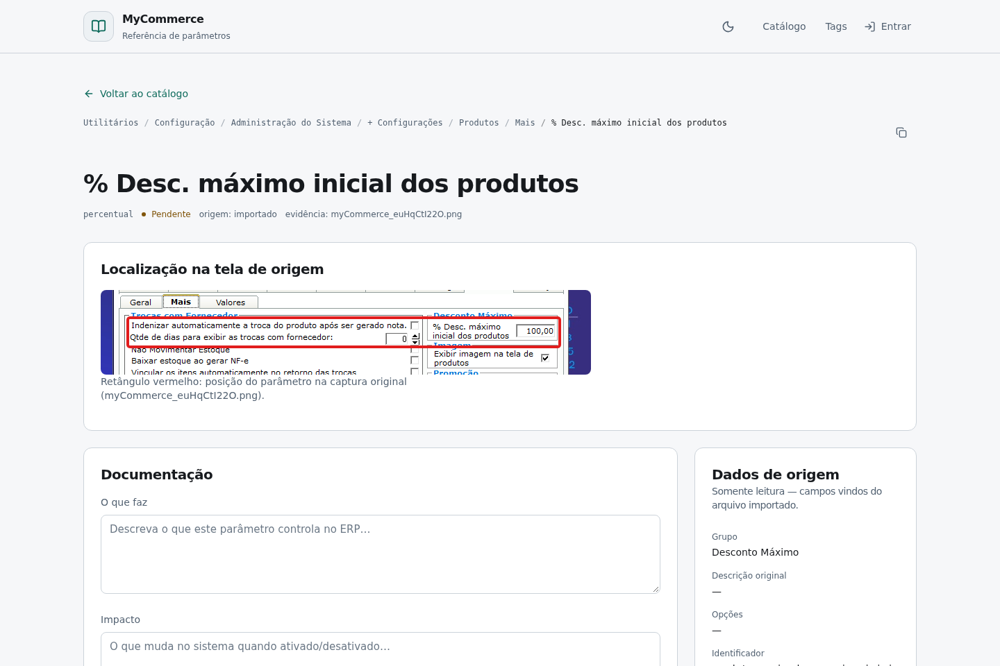
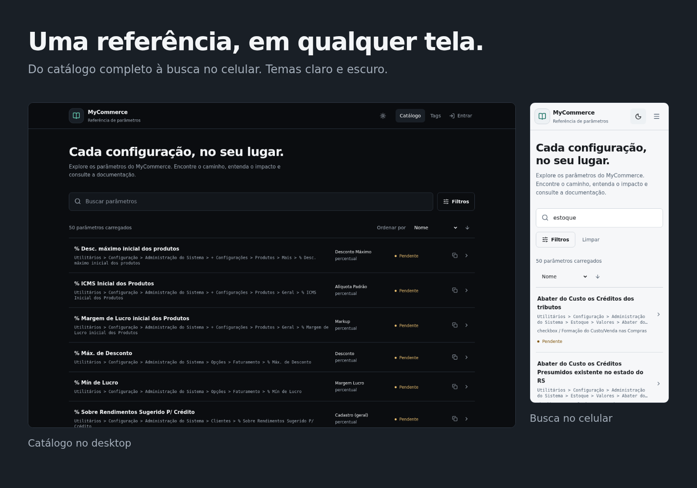
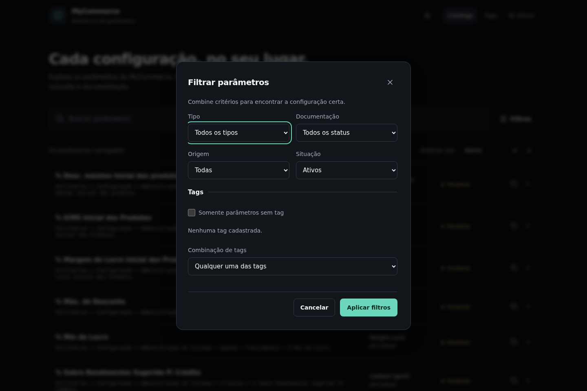

<a href="https://kaina-visualsoftware.github.io/Myc.config/">
  
</a>

# MyCommerce · Referência de parâmetros

**O caminho entre uma dúvida de configuração e o parâmetro certo.**

Consulte os parâmetros da **Administração do Sistema do ERP MyCommerce** em um catálogo pesquisável. Encontre o caminho no ERP, veja a captura de origem quando disponível e reúna a documentação que sua equipe usa no dia a dia.

**[Explorar o catálogo](https://kaina-visualsoftware.github.io/Myc.config/)** · [Ver o produto](#veja-o-produto-em-uso) · [Executar localmente](#executar-localmente) · [Documentação](#documentação-e-contribuição)

## Conhecimento para configurar com confiança

Uma configuração pode estar distribuída entre abas, grupos e menus com nomes parecidos. O catálogo aproxima essas referências em uma única consulta, para quem trabalha com **suporte, implantação e administração do MyCommerce**.

- **Encontre sem percorrer cada aba.** Pesquise por nome, grupo, caminho, descrição original ou pelo campo “O que faz” e compartilhe a busca pela URL.
- **Leve o contexto junto.** Consulte o tipo, o grupo e a localização do parâmetro; copie o caminho para orientar um atendimento.
- **Transforme experiência em referência.** Editores registram o que o parâmetro faz, seu impacto, valor padrão e observações, com status e histórico de alterações.

O catálogo é uma base de consulta e documentação. As mudanças de configuração do ERP são feitas no próprio MyCommerce. A consulta pública dispensa login; a edição exige uma conta com o papel adequado.

## Veja o produto em uso

### Encontre a configuração pelo que você sabe

Busca em destaque, caminho do ERP em cada resultado e status da documentação visível antes de abrir o detalhe.

<picture>
  <source media="(prefers-color-scheme: dark)" srcset="docs/assets/screenshots/catalogo-escuro.png">
  <source media="(prefers-color-scheme: light)" srcset="docs/assets/screenshots/catalogo-claro.png">
  
</picture>

### Reconheça o parâmetro na tela de origem

O detalhe combina caminho de navegação, dados importados e campos de documentação. Nos itens com imagem disponível, um recorte do ERP destaca a localização do parâmetro em vermelho.



### Consulte no desktop ou no celular

A interface adapta a navegação e os resultados ao tamanho da tela. Os temas claro e escuro mantêm a mesma organização da informação.

[](docs/assets/screenshots/busca-mobile.png)

<details>
<summary><strong>Veja também os filtros combináveis</strong></summary>

Refine a consulta por tipo, status da documentação, origem, situação e tags. As tags podem ser combinadas por “qualquer uma” ou “todas”.



</details>

*Capturas do site público, em sessão anônima. Os itens exibidos estão pendentes de documentação e não havia tags cadastradas na captura. [Origem e reprodução das imagens](docs/assets/README.md).*

## Da consulta à manutenção do catálogo

| Recurso | O que permite fazer |
| --- | --- |
| **Busca compartilhável** | Buscar com debounce, combinar filtros, ordenar resultados e recuperar a consulta pela URL. A paginação por cursor carrega mais itens sob demanda. |
| **Referência ao ERP** | Consultar o caminho completo, copiá-lo e visualizar a captura de origem quando o parâmetro possui imagem marcada. |
| **Documentação colaborativa** | Registrar explicação, impacto, valor padrão e observações; acompanhar os estados pendente, documentado e revisado. O histórico é acessível a usuários autenticados. |
| **Organização por tags** | Criar e associar tags, consultar uma categoria e exportar seus itens carregados em JSON. Administradores podem renomear e mesclar tags. |
| **Importação com prévia** | Importar JSON plano pela interface ou CLI, simular antes de gravar e revisar conflitos. A reimportação preserva a documentação manual e não apaga itens ausentes na origem. |
| **Administração do catálogo** | Criar parâmetros manualmente, gerenciar abas e recalcular caminhos. Papéis de leitor, editor e administrador são usados nas políticas de acesso do banco. |

### Uma interface feita para consulta recorrente

- Atalhos `/` e `Ctrl/Cmd + K` levam à busca.
- Preferência de tema salva no navegador.
- Foco visível, link para pular ao conteúdo, campos rotulados e respeito à preferência por movimento reduzido.
- Resultados responsivos e filtros em diálogo, com ações de aplicar e limpar.

## Tecnologias e arquitetura

| Camada | Tecnologias e responsabilidade |
| --- | --- |
| Interface | **React 18, TypeScript, Vite, Tailwind CSS 4 e Lucide** para páginas, componentes e identidade visual. |
| Navegação e consultas | **React Router** com `HashRouter` para rotas em hospedagem estática; **TanStack Query** para cache e estado das consultas. |
| Dados e acesso | **Supabase** com PostgreSQL, Auth, funções SQL e segurança em nível de linha (**RLS**). |
| Operação | Scripts TypeScript com **tsx** e **node-postgres** para migrações e importação; **Tesseract.js e Sharp** para localizar e destacar parâmetros nas imagens. |
| Entrega e verificação | **GitHub Pages e GitHub Actions**, testes com **Vitest** e suíte de navegador com **Playwright**. |

```text
Interface React → Serviços e casos de uso → Portas de dados → Supabase
                            ↓
                     Domínio TypeScript

CLI de importação → Mesmo caso de uso → Adaptador PostgreSQL
```

As regras de caminhos, normalização e comparação de importações ficam no domínio. A raiz de composição conecta a aplicação aos repositórios. A escrita é controlada no banco; esconder uma ação na interface não substitui autorização.

O frontend é estático. Um [proxy Cloudflare Worker opcional](worker/README.md) atende redes que bloqueiam chamadas diretas ao Supabase. Consulte a [arquitetura](docs/ARQUITETURA.md) e as [decisões técnicas](docs/DECISOES.md) para os detalhes.

## Executar localmente

### 1. Preparar o ambiente

Você precisa de **Node.js 22 ou superior**, npm e um projeto Supabase com o esquema e os dados do catálogo. Node.js 24 foi usado na validação desta documentação. O SDK Supabase resolvido no lockfile exige Node.js 22+.

```bash
git clone https://github.com/kaina-visualsoftware/Myc.config.git
cd Myc.config
npm ci
```

### 2. Configurar a conexão

Crie um arquivo `.env` na raiz:

```dotenv
VITE_SUPABASE_URL=https://SEU-PROJETO.supabase.co
VITE_SUPABASE_ANON_KEY=SUA-CHAVE-PUBLICA
```

Use a chave pública `anon` ou publishable do seu projeto. Variáveis `VITE_*` são incluídas no frontend: **não coloque `service_role`, senha do banco ou token privado do GitHub nelas**. Se já houver um `.env.local`, confira seus valores: ele tem precedência no Vite.

**Banco novo?** Siga a [configuração do Supabase](docs/DESENVOLVIMENTO.md#preparar-um-projeto-supabase) para aplicar as migrações, importar os dados e provisionar o primeiro administrador. O aplicativo precisa desse serviço para consultar o catálogo.

### 3. Iniciar

```bash
npm run dev
```

Abra **http://localhost:5173/**. A consulta funciona sem autenticação; entre com uma conta autorizada para editar.

### 4. Validar e gerar a versão de produção

```bash
npm test
npm run verificar-origem
npm run build
npm run preview
```

O build verifica os tipos e gera `dist/`. Na prévia, abra **http://localhost:4173/Myc.config/**, conforme a base configurada no Vite.

Os testes de banco requerem um PostgreSQL local descartável. A suíte E2E tem uma divergência de caminho entre sua configuração e o build atual; veja [testes e limitações conhecidas](docs/DESENVOLVIMENTO.md#testes-e-limitações-conhecidas) antes de executá-la.

## Documentação e contribuição

| Guia | Conteúdo |
| --- | --- |
| [Desenvolvimento e operação](docs/DESENVOLVIMENTO.md) | Variáveis de ambiente, migrações, importação, primeiro administrador, testes e publicação. |
| [Arquitetura](docs/ARQUITETURA.md) | Camadas, responsabilidades e fluxos principais. |
| [Decisões técnicas](docs/DECISOES.md) | Premissas e evolução das escolhas de implementação. |
| [Imagens de origem](docs/PLANO-IMAGENS.md) | Pipeline de OCR, recortes e limitações do destaque visual. |
| [Proxy opcional](worker/README.md) | Configuração e operação do Cloudflare Worker. |
| [Recursos visuais deste README](docs/assets/README.md) | Fontes editáveis, procedência das capturas e comandos de reprodução. |

Para sugerir uma correção ou relatar um problema, [abra uma issue](https://github.com/kaina-visualsoftware/Myc.config/issues). Inclua o caminho ou a URL do parâmetro e descreva o resultado esperado.

Para contribuir com código ou documentação:

1. Faça um fork e crie uma branch: `git checkout -b feature/sua-melhoria`.
2. Implemente a mudança e execute os testes pertinentes, além de `npm run build`.
3. Faça o commit, envie a branch ao seu fork e abra um pull request com contexto e evidências da alteração.

Contato do projeto: [kaina.visualsoftware@gmail.com](mailto:kaina.visualsoftware@gmail.com).

### Licença

O README anterior mencionava MIT, mas este repositório não contém um arquivo `LICENSE`. A licença precisa ser formalizada pelo mantenedor; a referência anterior, isoladamente, não permite confirmar seus termos.

---

**Comece por uma configuração que você usa todos os dias.** [Abra o catálogo](https://kaina-visualsoftware.github.io/Myc.config/), encontre o parâmetro e explore seu contexto.


## Conferir permissões de administrador

A edição administrativa só é liberada quando a tabela pública `profiles` contém `papel = 'administrador'` para o ID do usuário autenticado. Fazer login não altera automaticamente o papel. A interface mostra `Papel: ...` no cabeçalho.

No SQL Editor do Supabase, consulte o perfil por identificador (não pela senha):

```sql
select id, papel from public.profiles where id = '<UUID_DO_USUARIO_NO_AUTH>';
```

Para promover uma conta existente, utilize no ambiente administrativo local o script `npm run criar-admin` com `SUPABASE_URL`, `SUPABASE_SERVICE_ROLE_KEY` e `ADMIN_USER_ID`. Não use prefixo `VITE_` em segredos de servidor, não publique arquivos `.env` e nunca envie a service role ao navegador. O script valida a promoção lendo novamente o perfil.

**Segurança:** versões antigas do repositório incluíam credenciais fixas no script de criação de administrador. Altere imediatamente qualquer senha exposta e revogue sessões comprometidas pelo painel do Supabase, mesmo que o arquivo atual já tenha sido corrigido. Remover o conteúdo da versão atual não apaga o histórico do Git.

O JSON de origem nem sempre possui descrição: quando `descricao` é `null`, o catálogo não pode gerar um texto fiel automaticamente. A descrição pode ser escrita manualmente por editores ou administradores no campo `O que faz`.
