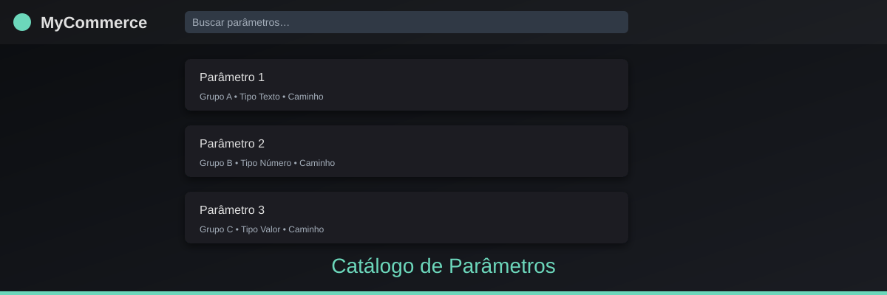
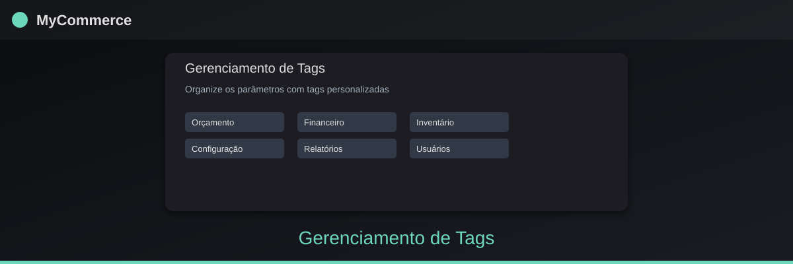

# MyCommerce – Catálogo de Parâmetros

**Visão geral**

O *MyCommerce Parametros* é um catálogo online que reúne, de forma centralizada e pesquisável, todos os parâmetros configuráveis da tela *Utilitários > Configuração > Administração do Sistema* do ERP MyCommerce. Desenvolvido com React, Vite, Supabase e Tailwind CSS, o aplicativo oferece uma interface limpa, rápida e segura para **consultar, documentar e gerenciar** esses parâmetros.

**Principais benefícios**

- **Descoberta instantânea** – localize qualquer parâmetro pelo nome, grupo ou caminho completo em segundos.
- **Documentação colaborativa** – editores podem acrescentar descrição, impacto e status; administradores controlam quem pode criar ou alterar.
- **Filtros avançados** – combine tags, status, tipo e origem para refinar a busca.
- **Histórico completo** – registre quem alterou o quê, garantindo auditoria e rastreabilidade.
- **Tema claro/escuro** – experiência visual adaptada ao ambiente de trabalho.
- **Segurança por RLS** – políticas de linha‑de‑comando do Supabase protegem os dados; nenhum segredo fica no front‑end.

**Funcionalidades chave**

- Busca rápida com debounce e filtragem por URL compartilhável.
- Paginação por cursor para desempenho em grandes volumes.
- Breadcrumb que exibe o caminho ERP (`Utilitários > Configuração > …`).
- Edição de documentação (campo “O que faz”, “Impacto”, “Valor padrão”, etc.).
- Gerenciamento de tags: criação, renomeação, associação e mesclagem.
- Importação idempotente de arquivos de origem com relatório de conflitos.
- Criação de novos parâmetros a partir de abas/menus do ERP.

**Demo**

Acesse a aplicação hospedada em: https://kaina-visualsoftware.github.io/Magno-Parametros/

**Capturas de tela**

**Como contribuir**

1. Fork do repositório.
2. Crie uma branch (`git checkout -b feature/xyz`).
3. Commit das alterações (`git commit -m "Descrição concisa"`).
4. Push e abra Pull Request.

**Licença**

MIT – veja o arquivo `LICENSE`.

**Contato**

Dúvidas ou sugestões: kaina.visualsoftware@gmail.com
